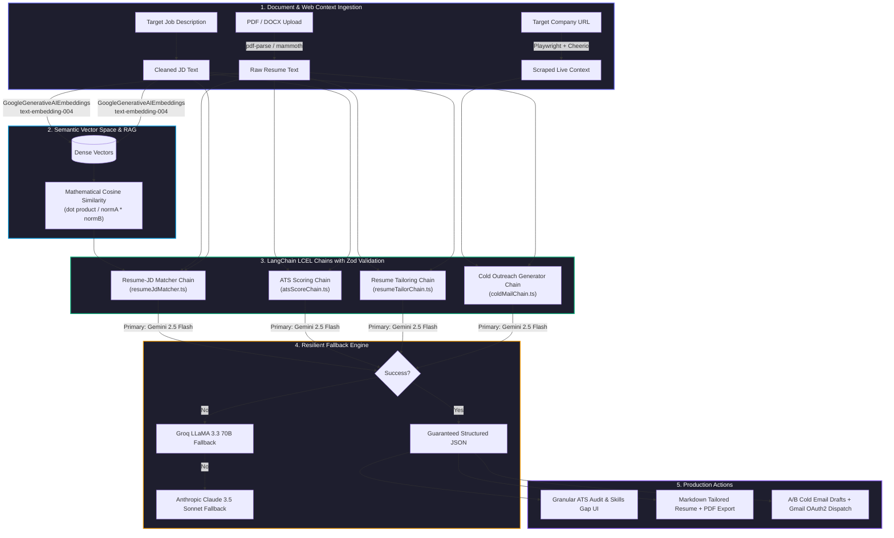
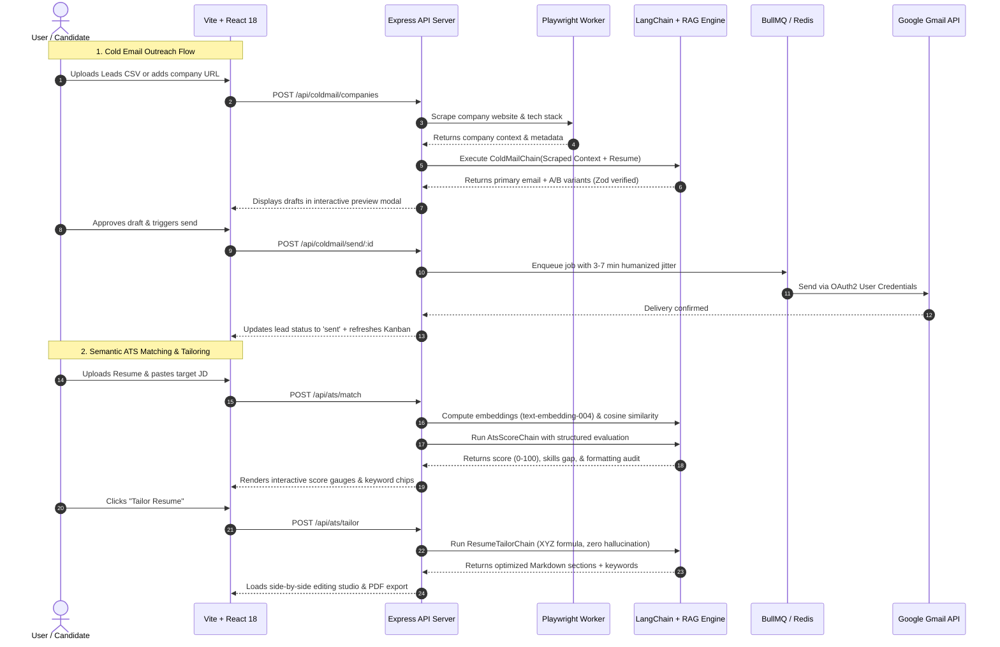

<div align="center">

# 🌌 Outly

### *AI-Powered Career Outreach & Resume Intelligence Platform*

**Outly** is a production-ready, full-stack career acceleration engine built with **TypeScript**, **LangChain**, and **Google Gemini**. It automates the tedious job hunt pipeline by combining **Retrieval-Augmented Generation (RAG)**, **vector semantic embeddings**, **automated company web-scraping**, and **ATS optimization** with a human-mimicking outreach dispatch system.

[](https://outly.online)
[](https://js.langchain.com/)
[](https://ai.google.dev/)
[](#-advanced-ai--rag-architecture)
[](#)
[](#)

<br/>

---

**[🌐 Live Demo](https://outly.online)** &nbsp;|&nbsp; **[🧠 AI & RAG Architecture](#-advanced-ai--rag-architecture)** &nbsp;|&nbsp; **[⚡ Key Features](#-features--capabilities)** &nbsp;|&nbsp; **[🛠️ System Design](#️-system-architecture)** &nbsp;|&nbsp; **[🔌 API Docs](#-api-endpoints)** &nbsp;|&nbsp; **[🚀 Quickstart](#-getting-started)** &nbsp;|&nbsp; **[👨‍💻 Hire the Developer](#-built-by-bharat-dhuva)**

---

</div>

## 🎯 The Problem & The Engineering Solution

| The Manual Job Hunt Bottleneck | How Outly Solves It With Applied AI |
| :--- | :--- |
| **Generic, ignored cold emails** sent blindly to recruiters without company context | **RAG-Powered Scraper**: Scrapes live company websites using Playwright/Cheerio, extracts business context, and feeds it into LangChain to draft hyper-personalized emails. |
| **Silent rejection by ATS bots** due to missing keywords and unstructured phrasing | **Vector Semantic Matching**: Compares resume text to JDs using `text-embedding-004` cosine similarity + a multi-point LangChain scoring audit with structured Zod schemas. |
| **Hours spent manually rewriting resumes** for each individual application | **Deterministic Resume Tailoring**: LangChain LCEL chain reorganizes and rewrites bullet points to match the JD using the Google XYZ formula without hallucinating facts. |
| **Spreadsheet chaos & lost leads** across multiple job boards | **Integrated Kanban CRM**: Drag-and-drop pipeline synchronized with Gmail API tracking, auto-scheduled follow-ups, and activity history. |

---

## 🧠 Advanced AI & RAG Architecture

Outly is engineered around production-grade LLM design patterns using **LangChain Expression Language (LCEL)**, strict **Zod runtime schemas**, and **Retrieval-Augmented Generation (RAG)**:



### 1. Vector Embeddings & Semantic Resume-JD Matcher (`python-ats/app/services/matcher.py`)
* **Service Architecture**: Migrated to Python 3.11+ FastAPI microservice using LangChain and Pydantic v2.
* **Vector Models**: LangChain Google Gemini embeddings (`models/gemini-embedding-001`) with automatic SHA-256 vector caching, and an offline local **TF-IDF cosine similarity fallback**.
* **Hybrid Multi-Factor Scoring**: Blends weighted normalized skill taxonomy overlap (must-have skills count 2x vs nice-to-have), semantic vector proximity, and experience seniority alignment into an advisory non-rejecting score.

### 2. Explainable ATS Resume Audit Engine (`python-ats/app/services/ats.py`)
* **Deterministic Rules Engine**: Audits 27 concrete factors across 6 categories: Contact Info (10 pts), Section Structure (20 pts), Length & Format (10 pts), Bullet Point Quality (20 pts), Keyword Coverage (25 pts), and Readability (15 pts).
* **LangChain LCEL Structured Output Layer**: Uses Google Gemini (`gemini-2.5-flash`) structured output to deliver concrete section rewrite suggestions and strengths/weaknesses strictly bounded to facts present in the resume.
* **Offline Resilient**: If no API key is provided or the LLM is unavailable, returns the complete deterministic report with `llm_analysis = null`.

### 3. Precision Resume Tailor Engine (`python-ats/app/services/ats.py` & `llm.py`)
* **Context-Aware Section Rewrites**: Tailors the resume section-by-section (Summary, Skills, Experience Bullets, Projects) to mirror the exact competencies prioritized in the JD.
* **Anti-Hallucination Integrity Rules**: Strict prompt governance forbids fabricating degrees, past employers, dates, or non-existent job titles.
* **Google XYZ Formula**: Automatically rephrases bullet points into *"Accomplished [X], as measured by [Y], by doing [Z]"* format.


### 4. RAG-Augmented Cold Email Outreach Engine (`coldMailChain.ts`)
* **Live Web Retrieval (RAG)**: Playwright + Cheerio scrape the target company's landing page, engineering blog, and value proposition in real time.
* **Context Fusion**: Merges candidate profile data, resume strengths, target recipient persona, and scraped company intelligence into a unified LangChain `ChatPromptTemplate`.
* **Multi-Angle A/B Generation**: Generates 2 distinct psychological email variants:
  * **Variant A (Metrics & Impact)**: Focuses on engineering velocity, scalability, and measurable outcomes.
  * **Variant B (Problem-Solver)**: Focuses on relieving team bandwidth constraints and specific tech stack synergies.
* **Deliverability Guards**: Automates anti-spam formatting, humanized sign-offs, and randomized dispatch jitter (3-7 minutes) via BullMQ Redis.

---

## ⚡ Features & Capabilities

### 🟢 Live & Fully Integrated

#### 📧 AI Cold Email Outreach Engine
* **Lead CRM & Bulk CSV Ingestion**: Import recruiter and hiring manager contacts via CSV or manually via an interactive modal.
* **Real-Time Website Scraper**: Playwright-powered background scraper (`companyScraper.ts`) extracts mission statements, tech stacks, and company news.
* **LangChain Cold Mail Generator**: Synthesizes scraped context with candidate strengths to output personalized email drafts and subject lines.
* **Google Gmail OAuth2 Sender**: Dispatches emails straight from the candidate's authentic Gmail inbox via the official Google APIs (no generic SMTP or third-party relay flags).
* **BullMQ Queue with Human Jitter**: Backed by Redis to process email delivery with randomized 3 to 7 minute delays to protect sender domain reputation.
* **Automated Follow-Up Engine**: Node-cron cron jobs detect unanswered threads and draft contextual follow-up reminders.

#### 🎯 ATS Resume Evaluation & Semantic Matcher
* **Dual Scoring Engine**: Run a universal ATS readiness check or match against a specific target Job Description.
* **Visual Skills Gap Breakdown**: Displays matched competencies alongside missing hard skills, soft skills, and required tooling.
* **Vector Similarity Indicator**: Displays semantic cosine distance calculated from dense vector embeddings.

#### 📄 Resume Tailoring & Document Vault
* **Section-Wise Editing Studio**: Review side-by-side comparisons of original vs. tailored bullet points.
* **Multi-Format Ingestion**: Extracts text accurately from `.pdf` and `.docx` using `pdf-parse` and `mammoth`.
* **Cloud & Hybrid Storage**: Dual storage model using Cloudinary for CDN assets and Base64-encoded records in MongoDB Atlas for instant retrieval.
* **PDF Compiler**: Export optimized resumes directly to clean, print-ready PDF formats.

#### 📋 Visual Kanban Application Tracker
* **Interactive Drag-and-Drop Pipeline**: Manage applications across `Saved` ➔ `Applied` ➔ `Interview` ➔ `Offer` ➔ `Rejected` stages.
* **Audit Logs & Notes**: Attach custom notes, salary ranges, resume version used, and email correspondence to each application card.

#### 🔍 Playwright Job Finder Scraper
* **Live Job Search**: Scrapes real-time postings tailored to role titles, preferred locations, and experience thresholds.
* **1-Click Import**: Save discovered listings directly into your Kanban pipeline with zero copy-pasting.

#### 📊 Performance Analytics & Command Center
* **Recharts Dashboard**: Track open rates, response rates, top-performing subject lines, and weekly application volumes.
* **Quick Command Palette (⌘K / Ctrl+K)**: Search leads, resumes, and navigate views with keyboard-first shortcuts.

#### 💳 Monetization & Access Control
* **Razorpay Subscriptions**: Secure subscription order creation and HMAC webhook verification for Pro tier upgrades.
* **Granular Tier Limits**: Built-in middleware enforcing daily quotas on free accounts with real-time UI warnings.

---

## 🛠️ System Architecture



---

## 💻 Technical Stack

### Core AI & LangChain Layer
| Library / Tool | Version / Spec | Role in Outly |
| :--- | :--- | :--- |
| **LangChain Core** | `@langchain/core` | Prompt templates (`ChatPromptTemplate`), output parsers, runnable pipelines |
| **LangChain Google GenAI** | `@langchain/google-genai` | Native chat model wrappers and vector embedding generators |
| **Primary LLM** | `gemini-2.5-flash` | High-speed, structured text generation, resume rewriting, cold email crafting |
| **Vector Embeddings** | `text-embedding-004` | 768-dimensional dense vector embeddings for semantic document similarity |
| **Schema Validation** | `zod` | Strict runtime typing for structured LLM outputs, preventing malformed responses |
| **Fallback Models** | `llama-3.3-70b` (Groq), `claude-3-5-sonnet` | High-availability resilience fallbacks if primary quota or rate limits are met |

### Full-Stack Infrastructure
| Layer | Technologies | Purpose |
| :--- | :--- | :--- |
| **Frontend Framework** | React 18, Vite 5, TypeScript | Responsive, modern Single Page Application with strict type safety |
| **Styling & Design** | TailwindCSS, Shadcn/UI (Radix primitives) | Polished dark-mode UI with high accessibility and sleek micro-interactions |
| **Animations** | Framer Motion, GSAP | Page-transition smoothing and animated data visualization counters |
| **State & Data Fetching** | TanStack React Query, React Hook Form | Query caching, optimistic UI updates, and performant form validation |
| **Backend Runtime** | Node.js (v18+), Express 4, TypeScript | Modular RESTful API server with custom error boundaries and rate limiters |
| **Primary Database** | MongoDB Atlas, Mongoose 9 | Scalable cloud document database for users, leads, resumes, and Kanban states |
| **Asynchronous Queues** | Redis, Bull / BullMQ | Persistent background job processing with rate limiting and retry backoff |
| **Web Scraping** | Playwright, Cheerio | Headless browser execution for real-time company intelligence and job crawling |
| **Email Transport** | Google OAuth2 API, Nodemailer | Direct inbox authorization bypassing spam filters and SMTP restrictions |
| **File Storage** | Cloudinary API, MongoDB Base64 | Dual storage architecture for fast CDN delivery and persistent backup |

---

## 📁 Codebase Directory Structure

```
Outly/
├── api/
│   └── index.js                      # Vercel serverless entry gateway
├── backend/
│   ├── src/
│   │   ├── index.ts                  # Server bootstrap & lifecycle manager
│   │   ├── ai/                       # 🦜🔗 LangChain & AI Orchestration Layer
│   │   │   ├── llm.ts                # Gemini model & embedding initializers + cosine similarity
│   │   │   ├── prompts.ts            # LangChain ChatPromptTemplates for all features
│   │   │   ├── resumeJdMatcher.ts    # Semantic vector embedding comparison engine
│   │   │   ├── atsScoreChain.ts      # ATS evaluation chain with Zod schema output
│   │   │   ├── resumeTailorChain.ts  # Section-wise resume rewrite engine (XYZ formula)
│   │   │   ├── coldMailChain.ts      # RAG-augmented cold outreach chain with A/B variants
│   │   │   ├── testE2MJobRun.ts      # E2E test suite running all 4 LangChain chains
│   │   │   └── index.ts              # Central AI module exports
│   │   ├── api/
│   │   │   ├── server.ts             # Express middleware, CORS, and route aggregation
│   │   │   └── routes/               # Modular REST endpoints (ats, coldmail, auth, etc.)
│   │   ├── automation/
│   │   │   └── coldmail/             # Scrapers (Playwright), CSV parsers, mail dispatchers
│   │   ├── db/                       # Mongoose schemas (users, companies, resumes, applications)
│   │   ├── queue/                    # Redis-backed Bull queues for cold mail dispatching
│   │   ├── jobs/                     # Scheduled cron jobs for follow-up reminders
│   │   ├── middleware/               # JWT auth guards, tier limiters, upload handlers
│   │   └── config/                   # Strongly typed environment configuration
│   └── package.json
├── frontend/
│   ├── src/
│   │   ├── App.tsx                   # Client routing table (18+ routes)
│   │   ├── pages/                    # Dedicated view modules
│   │   │   ├── AtsScore.tsx          # Interactive ATS evaluation & keyword gap analysis
│   │   │   ├── ResumeTailor.tsx      # Split-screen resume customization workspace
│   │   │   ├── ColdMail.tsx          # Outreach campaign manager & A/B draft selector
│   │   │   ├── JobFinder.tsx         # Live Playwright job listings search
│   │   │   ├── Applications.tsx      # Drag-and-drop Kanban career tracker
│   │   │   └── ...                   # Analytics, Resume Vault, Onboarding, Mobile Hub
│   │   ├── components/               # Radix UI wrappers, charts, command palette (⌘K)
│   │   └── lib/                      # API client, query cache, formatting utilities
│   └── package.json
└── package.json                      # Workspace scripts
```

---

## 🔌 API Endpoints

### 🧠 AI & Resume Intelligence (`/api/ats` & `/api/resume`)
| Method | Endpoint | Description |
| :--- | :--- | :--- |
| `POST` | `/api/ats/score` | Evaluates resume against target JD using LangChain `scoreResumeChain` (Zod structured output) |
| `POST` | `/api/ats/match` | Computes semantic vector embeddings (`text-embedding-004`) and cosine similarity |
| `POST` | `/api/ats/tailor` | Executes `tailorResumeChain` to rewrite resume sections matching JD requirements |
| `POST` | `/api/ats/parse-file`| Extracts plain text from uploaded `.pdf` or `.docx` files |
| `GET` | `/api/resume` | Fetches candidate's stored resume versions from MongoDB/Cloudinary |
| `POST` | `/api/resume/upload` | Uploads and processes a new resume into the cloud vault |
| `PUT` | `/api/resume/:id/default`| Sets preferred default resume for 1-click applications |

### 📧 Cold Outreach Automation (`/api/coldmail`)
| Method | Endpoint | Description |
| :--- | :--- | :--- |
| `GET` | `/api/coldmail/companies` | Retrieves all company leads and outreach campaign states |
| `POST` | `/api/coldmail/companies` | Manually creates a new company lead target |
| `POST` | `/api/coldmail/upload-csv` | Parses and batch imports recruiter contacts via CSV |
| `POST` | `/api/coldmail/scrape/:id`| Triggers Playwright worker to scrape live website context |
| `POST` | `/api/coldmail/generate/:id`| Executes LangChain `coldMailChain` using scraped web context to produce A/B drafts |
| `POST` | `/api/coldmail/send/:id` | Enqueues personalized email to Redis BullMQ with anti-spam jitter delay |

### 📋 Job Tracker & CRM (`/api/applications`)
| Method | Endpoint | Description |
| :--- | :--- | :--- |
| `GET` | `/api/applications` | Fetches all tracked jobs grouped by Kanban stages |
| `POST` | `/api/applications` | Adds a newly discovered job card to the pipeline |
| `PUT` | `/api/applications/:id/stage`| Updates application column (`saved`, `applied`, `interview`, etc.) |
| `PUT` | `/api/applications/:id` | Updates salary, interview notes, or recruiter touchpoints |
| `DELETE`| `/api/applications/:id` | Removes an application card from the board |

### 🔐 Authentication & Accounts (`/api/auth`)
| Method | Endpoint | Description |
| :--- | :--- | :--- |
| `POST` | `/api/auth/signup` | Native registration with `bcrypt` salt hashing |
| `POST` | `/api/auth/login` | Issues signed JWT access token |
| `POST` | `/api/auth/google` | Google OAuth2 token exchange |
| `GET` | `/api/auth/me` | Retrieves authenticated user profile & plan quotas |
| `GET` | `/api/auth/ping` | Lightweight healthcheck route used for backend pre-warming |

---

## ⚡ Getting Started

### Prerequisites
* **Node.js** (v18.0.0 or higher)
* **MongoDB Atlas** database connection URI
* **Redis** server (Optional for local development; required for Bull queue dispatching)
* **Google Gemini API Key** ([Get one here](https://aistudio.google.com/))

### 1. Clone & Install
```bash
git clone https://github.com/bharatdhuva/Outly.git
cd Outly
npm install
```

### 2. Configure Backend Environment
```bash
cd backend
cp .env.example .env
```
Populate `.env` with your credentials:
```env
PORT=3001
MONGODB_URI=mongodb+srv://<user>:<password>@cluster.mongodb.net/outly
JWT_SECRET=your_jwt_secret_key
GEMINI_API_KEY=your_gemini_api_key

# Optional Multi-LLM Resilient Fallbacks
GROK_API_KEY=your_groq_api_key
CLAUDE_API_KEY=your_anthropic_api_key

# Google OAuth2 & Gmail Dispatching
GMAIL_CLIENT_ID=your_oauth_client_id.apps.googleusercontent.com
GMAIL_CLIENT_SECRET=your_oauth_client_secret
GMAIL_REFRESH_TOKEN=your_oauth_refresh_token
GMAIL_USER=your_sending_address@gmail.com

# Cloudinary Storage
CLOUDINARY_CLOUD_NAME=your_cloud_name
CLOUDINARY_API_KEY=your_cloudinary_key
CLOUDINARY_API_SECRET=your_cloudinary_secret

# Redis (for background Bull queue)
REDIS_URL=redis://127.0.0.1:6379
```

### 3. Run the LangChain AI Test Suite
Validate that all LangChain chains and vector similarity calculations execute cleanly:
```bash
npx tsx src/ai/testE2MJobRun.ts
```

### 4. Start the Application
Start both backend and frontend concurrently from the root directory:
```bash
# Terminal 1: Backend
cd backend
npm run dev

# Terminal 2: Frontend
cd frontend
npm run dev
```
Open **[http://localhost:5173](http://localhost:5173)** in your browser.

---

## 🛡️ Production Engineering: Cold-Start Mitigation

When deployed on free tiers (like Render, Railway, or Vercel serverless functions), instances often spin down after 15 minutes of inactivity. Outly implements two proactive design solutions to eliminate cold-start lag:

1. **Client-Side Predictive Warming**: When any visitor navigates to the landing page (`/`) or opens the authentication modal (`/login`), the React client fires an asynchronous, non-blocking `GET /api/auth/ping` request. This initializes the server process and warms up the MongoDB Atlas connection pool before credentials are submitted.
2. **Scheduled Keep-Alive Monitor**: For zero cold-start latency, a simple HTTP check targeting `https://outly.online/api/auth/ping` running every 10 minutes (via UptimeRobot or Cron-Job.org) maintains 100% warm-state availability without incurring compute costs.

---

## 💎 Free vs Pro Plan Matrix

| Feature | Free Community Tier | Pro Career Tier |
| :--- | :---: | :---: |
| **Resume Vault Storage** | Up to 3 Versions | Unlimited Versions |
| **Daily ATS Evaluations** | 3 Audits / Day | Unlimited Evaluations |
| **LangChain Vector Similarity** | Included | Included |
| **Cold Outreach Sends** | 5 Emails / Day | Unlimited Emails |
| **A/B Email Angle Generation** | Included | Included |
| **Automated Follow-Up Cron** | Manual Only | Automated Cron Pipeline |
| **Kanban Pipeline Tracking** | Unlimited Cards | Unlimited Cards |
| **Priority Support** | Standard | Dedicated Discord / Email |

---

<div align="center">

## 👨‍💻 Built by Bharat Dhuva

**Full-Stack & Applied AI Engineer**  
Specializing in **TypeScript, LangChain, RAG Systems, Node.js, and Modern Web Architectures.**

Looking for an engineer who builds high-impact AI products from scratch with clean code, scalable architecture, and strict attention to detail? **Let's connect.**

[](https://bharatdhuva.com)
[](https://linkedin.com/in/bharatdhuva27)
[](https://github.com/bharatdhuva)
[](mailto:bharatdhuva27@gmail.com)

---

*Star ⭐ this repository if you find it helpful!*

</div>
