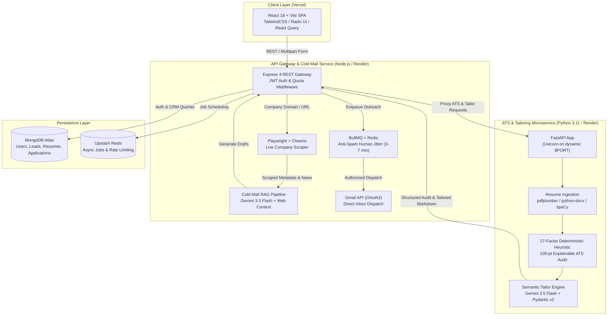

<div align="center">

# 🌌 Outly
### *Production-Grade AI Career Outreach & Resume Intelligence Platform*

[](https://outly.online)
[](https://nodejs.org/)
[](https://fastapi.tiangolo.com/)
[](https://ai.google.dev/)
[](https://react.dev/)
[](https://bullmq.io/)

<br/>

**[🌐 Live Demo](https://outly.online)** &nbsp;•&nbsp;
**[🏗️ Architecture](#️-system-architecture)** &nbsp;•&nbsp;
**[⚡ Core Engines](#-core-platform-engines)** &nbsp;•&nbsp;
**[💻 Tech Stack](#-technical-stack)** &nbsp;•&nbsp;
**[🔌 API Reference](#-api-endpoints)** &nbsp;•&nbsp;
**[🚀 Local Setup](#-getting-started)** &nbsp;•&nbsp;
**[👨‍💻 Author](#-built-by-bharat-dhuva)**

---

</div>

## 📌 Executive Summary

**Outly** is an end-to-end career acceleration system designed to eliminate the friction of modern technical job hunting. Instead of sending generic cold outreach and blind resume submissions, Outly operates as a distributed multi-service platform:

1. **RAG Cold Outreach Engine**: Scrapes target company infrastructure, tech stacks, and recent developments in real time, synthesizing personalized email campaigns dispatched via authenticated Gmail OAuth2.
2. **27-Factor ATS Diagnostic Engine**: A high-speed Python FastAPI microservice that parses resumes with `pdfplumber` and `spaCy`, executes a deterministic 27-point heuristic audit, and produces structured improvement advice with Google Gemini 3.5 Flash.
3. **Precision Resume Tailoring**: Contextually aligns resume bullet points to target Job Descriptions using the Google XYZ formula (*"Accomplished [X], as measured by [Y], by doing [Z]"*) under strict anti-hallucination constraints.
4. **Application CRM & Kanban**: A unified workflow pipeline with automated Gmail thread synchronization, interview notes, and activity analytics.

---

## 🏗️ System Architecture

Outly is engineered as a decoupled microservice architecture for maximum throughput, isolation of heavy NLP tasks, and zero cold-start latency:



---

## ⚡ Core Platform Engines

### 1. 📧 Cold Outreach RAG Engine (`backend/src/automation/coldmail/`)
* **Real-Time Web Scraper**: Crawls target domains using Playwright and Cheerio, extracting product offerings, engineering stack, mission statements, and leadership details.
* **Autonomous AI Research Fallback**: If a company website is inaccessible or heavily firewalled, an automated Gemini 3.5 Flash researcher extracts factual intelligence about the company before synthesis.
* **Anti-Hallucination Email Synthesis**: Combines candidate achievements with scraped company context. Strictly prohibits generic flattery and enforces citing verified company initiatives.
* **A/B Angle Generation**: Synthesizes two distinct psychological angles per lead:
  * **Angle A (Impact & Metrics)**: Focuses on engineering velocity, cost reduction, and architecture scaling.
  * **Angle B (Problem-Solver)**: Focuses on immediate team pain points, tool synergies, and bandwidth relief.
* **Anti-Spam Transport**: Enqueues emails via Redis BullMQ with randomized 3–7 minute dispatch delays to protect sender domain reputation, sending directly through the candidate's authentic Gmail inbox via Google OAuth2.

### 2. 🎯 27-Factor ATS Diagnostic Engine (`python-ats/app/services/ats.py`)
* **Deterministic Rule Scoring**: Audits resumes against 27 concrete factors across 6 weighted categories:
  * **Contact & Links (10 pts)**: Email, phone, LinkedIn, GitHub, portfolio validation.
  * **Section Architecture (20 pts)**: Essential headings (Experience, Education, Skills, Projects).
  * **Length & Formatting (10 pts)**: Word count, page density, parseable bullet structures.
  * **Bullet Point Quality (20 pts)**: Action verb density, quantifiable metrics (`%`, `$`, scale numbers).
  * **Keyword & Skill Coverage (25 pts)**: Hard skills, frameworks, tooling, and domain concepts.
  * **Readability (15 pts)**: Average sentence length, passive voice detection, readability index.
* **Strictly Bounded LLM Analysis**: Uses Google Gemini 3.5 Flash with structured Pydantic schemas to generate concrete, high-signal rewrite suggestions without altering factual user data.
* **Zero Cold-Start Ingestion Resilience**: If the Python microservice is in a cold start, the Node.js backend includes a native `pdf-parse` and `mammoth` fallback parser to ensure uploads never fail.

### 3. 📄 Precision Resume Tailor (`python-ats/app/services/ats.py`)
* **Semantic Alignment**: Extracts requirements from target Job Descriptions and reorganizes candidate experience to spotlight relevant skills first.
* **Google XYZ Formula**: Automatically rephrases bullet points into *"Accomplished [X], as measured by [Y], by doing [Z]"*.
* **Zero-Hallucination Integrity Guard**: Prompts strictly enforce that no employers, degrees, metrics, or technologies not present in the original resume are ever invented.

### 4. 📋 Interactive Kanban Application Tracker (`frontend/src/pages/Applications.tsx`)
* **Drag-and-Drop Workflow**: Tracks applications through `Saved` ➔ `Applied` ➔ `Interviewing` ➔ `Offered` ➔ `Rejected`.
* **Deep Context**: Store custom salary ranges, recruiter emails, specific resume versions used, and notes on each card.

---

## 💻 Technical Stack

| Domain | Technology | Description |
| :--- | :--- | :--- |
| **Frontend** | React 18, Vite 5, TypeScript | Modern SPA with strict typing and lightning-fast HMR |
| **UI & Styling** | TailwindCSS, Radix UI Primitives, Lucide | Accessible, polished dark-mode interface with responsive components |
| **State & Data** | TanStack React Query v5 | Server state caching, optimistic UI updates, and automatic refetching |
| **API Gateway** | Node.js (v18+), Express 4, TypeScript | REST API gateway, rate limiting, JWT authentication, and file streaming |
| **AI Microservice** | Python 3.11, FastAPI, Uvicorn | High-performance asynchronous microservice for parsing, ATS, and tailoring |
| **NLP & Extraction** | spaCy (`en_core_web_sm`), pdfplumber, python-docx | Deep document extraction and entity parsing from PDF and DOCX files |
| **AI Models** | Google Gemini 3.5 Flash | High-speed structured LLM for Cold Mail RAG, ATS audits, and resume tailoring |
| **Database** | MongoDB Atlas, Mongoose 8 | Cloud document store for users, resumes, leads, and Kanban tracking |
| **Background Queues**| Redis, BullMQ | Asynchronous email dispatching with randomized jitter delays and retry backoff |
| **Automation** | Playwright, Cheerio | Headless browser for live company intelligence scraping |
| **Integrations** | Google OAuth2, Gmail API | Direct inbox authorization and email delivery |

---

## 📁 Codebase Structure

```
Outly/
├── backend/                          # Node.js Express API Gateway & Cold Mail RAG
│   ├── src/
│   │   ├── api/
│   │   │   ├── routes/               # Modular REST endpoints (ats, coldmail, auth, etc.)
│   │   │   └── server.ts             # Express configuration & middleware pipeline
│   │   ├── automation/coldmail/      # Scrapers (Playwright), CSV parsers, mail dispatchers
│   │   ├── config/                   # Strongly typed environment configuration
│   │   ├── db/                       # Mongoose schemas (User, Company, Resume, Application)
│   │   ├── jobs/                     # Keep-alive daemon routines & scheduled cron tasks
│   │   ├── queue/                    # Redis-backed BullMQ email dispatch queues
│   │   └── index.ts                  # Backend server entrypoint
│   └── package.json
│
├── python-ats/                       # Dedicated Python 3.11 FastAPI AI Microservice
│   ├── app/
│   │   ├── core/                     # Configuration & Gemini LLM client initializers
│   │   ├── schemas/                  # Pydantic v2 data models for ATS & tailoring
│   │   ├── services/                 # 27-factor heuristic engine, document parser, tailor
│   │   └── main.py                   # FastAPI application with CORS and dynamic health checks
│   ├── Dockerfile                    # Production container specification for Render
│   ├── run.py                        # Dynamic port-binding entrypoint
│   └── requirements.txt              # Production Python dependencies
│
├── frontend/                         # React 18 + Vite Single Page Application
│   ├── src/
│   │   ├── components/               # Reusable UI widgets, modals, layout elements
│   │   ├── pages/                    # Dedicated route views (AtsScore, ResumeTailor, ColdMail, etc.)
│   │   ├── lib/                      # Axios API client, query client, utility helpers
│   │   ├── App.tsx                   # Client routing configuration
│   │   └── main.tsx                  # React DOM bootstrap
│   └── package.json
│
└── README.md                         # Project documentation
```

---

## 🔌 API Endpoints

### AI & Resume Intelligence
| Method | Endpoint | Description |
| :--- | :--- | :--- |
| `POST` | `/api/ats/score` | Evaluates a resume text/file against 27 ATS heuristic factors + LLM advice |
| `POST` | `/api/ats/tailor` | Tailors a resume for a specific Job Description using Google XYZ format |
| `POST` | `/api/ats/parse-file` | Extracts clean raw text from uploaded `.pdf` or `.docx` files |
| `GET`  | `/api/resume` | Retrieves all stored resume versions for the authenticated user |
| `POST` | `/api/resume/upload` | Uploads and registers a new resume in the cloud vault |

### Cold Outreach Automation
| Method | Endpoint | Description |
| :--- | :--- | :--- |
| `GET`  | `/api/coldmail/companies` | Retrieves all company leads and outreach campaign statuses |
| `POST` | `/api/coldmail/companies` | Registers a new company lead target |
| `POST` | `/api/coldmail/upload-csv` | Batch imports recruiter contacts via CSV |
| `POST` | `/api/coldmail/scrape/:id` | Triggers Playwright worker to scrape live website context |
| `POST` | `/api/coldmail/generate/:id`| Executes Cold Mail RAG pipeline to generate personalized A/B drafts |
| `POST` | `/api/coldmail/send/:id` | Enqueues personalized email to BullMQ with anti-spam jitter delay |

### Application Kanban & CRM
| Method | Endpoint | Description |
| :--- | :--- | :--- |
| `GET`  | `/api/applications` | Fetches all tracked jobs grouped by Kanban stages |
| `POST` | `/api/applications` | Creates a new job application card |
| `PUT`  | `/api/applications/:id/stage`| Moves application across stages (`saved`, `applied`, `interview`, etc.) |
| `DELETE`| `/api/applications/:id` | Removes an application card from the board |

### Authentication & System
| Method | Endpoint | Description |
| :--- | :--- | :--- |
| `POST` | `/api/auth/signup` | Registers new user with `bcrypt` password hashing |
| `POST` | `/api/auth/login` | Authenticates user and issues signed JWT |
| `POST` | `/api/auth/google` | Exchanges Google OAuth2 token for user session |
| `GET`  | `/api/auth/ping` | Lightweight healthcheck route used for backend pre-warming |

---

## ⚡ Getting Started

### Prerequisites
* **Node.js**: v18.0.0 or higher
* **Python**: v3.11 or higher
* **MongoDB**: Atlas connection string or local instance (`mongodb://127.0.0.1:27017/outly`)
* **Redis**: Local server or Upstash connection URL
* **Google Gemini API Key**: [Google AI Studio](https://aistudio.google.com/)

---

### 1. Clone the Repository
```bash
git clone https://github.com/bharatdhuva/Outly.git
cd Outly
```

### 2. Configure Environment Variables

**Backend (`backend/.env`):**
```env
PORT=3001
MONGODB_URI=mongodb+srv://<user>:<password>@cluster.mongodb.net/outly
JWT_SECRET=your_jwt_secret_key
GEMINI_API_KEY=your_gemini_api_key

# Python Microservice Address
PYTHON_ATS_URL=http://127.0.0.1:8000

# Redis & BullMQ
REDIS_URL=redis://127.0.0.1:6379

# Google OAuth2 (for Gmail Outreach)
GMAIL_CLIENT_ID=your_oauth_client_id.apps.googleusercontent.com
GMAIL_CLIENT_SECRET=your_oauth_client_secret
GMAIL_REFRESH_TOKEN=your_oauth_refresh_token
GMAIL_USER=your_sending_address@gmail.com
```

**Python Microservice (`python-ats/.env`):**
```env
PORT=8000
GEMINI_API_KEY=your_gemini_api_key
GEMINI_MODEL=gemini-3.5-flash
ENVIRONMENT=development
```

**Frontend (`frontend/.env`):**
```env
VITE_API_BASE_URL=http://127.0.0.1:3001/api
```

---

### 3. Run Locally

Open three terminals to start the complete stack:

```bash
# Terminal 1: Python ATS Microservice
cd python-ats
python -m venv .venv
# Windows: .venv\Scripts\activate | Unix: source .venv/bin/activate
pip install -r requirements.txt
python -m spacy download en_core_web_sm
python run.py
```

```bash
# Terminal 2: Node.js Express Gateway
cd backend
npm install
npm run dev
```

```bash
# Terminal 3: React Vite Client
cd frontend
npm install
npm run dev
```

Navigate to **`http://localhost:5173`** (or `http://localhost:3000`) in your browser.

---

## 🛡️ Production & Reliability Engineering

* **Zero Cold-Start Strategy**: Free-tier cloud instances (e.g. Render) spin down during periods of inactivity. Outly deploys an integrated keep-alive daemon (`backend/src/jobs/keepAlive.cron.ts`) that pings both the Node.js API and the Python ATS microservice on a scheduled interval.
* **Client Pre-Warming**: When visitors land on the Outly landing page, the React client automatically fires a non-blocking `GET /api/auth/ping` pre-warm request to spin up database connection pools before user interaction.
* **Dual Parsing Redundancy**: Document parsing automatically falls back to Node.js `pdf-parse` / `mammoth` if the Python parser encounters unexpected I/O timeouts.

---

<div align="center">

## 👨‍💻 Built by Bharat Dhuva

**Full-Stack & Applied AI Engineer**  
Specializing in **TypeScript, Python, Distributed Systems, Applied RAG, and Modern Cloud Architecture.**

[](https://bharatdhuva.com)
[](https://linkedin.com/in/bharatdhuva27)
[](https://github.com/bharatdhuva)
[](mailto:bharatdhuva27@gmail.com)

---

⭐ *If you find Outly useful or interesting, please consider starring the repository!*

</div>
